# 119–161 MHz Lumped-Element Band-Pass Filter (Keysight ADS)

This is the design of a 50 Ω VHF band-pass filter, built as a cascade of a **7th-order elliptic low-pass** and an **elliptic-type high-pass** section. The flow goes from an ADS DesignGuide prototype, through finite-Q components, extra transmission zeros and gradient optimisation, to **real Coilcraft 0603DC inductors**. An independent **Python re-simulation** checks the ADS results and adds a **component-tolerance (Monte-Carlo) analysis**.

> **Course:** Communication Circuits (Prof. Z. Seifi), Amirkabir University of Technology. ADS project.

<p align="center">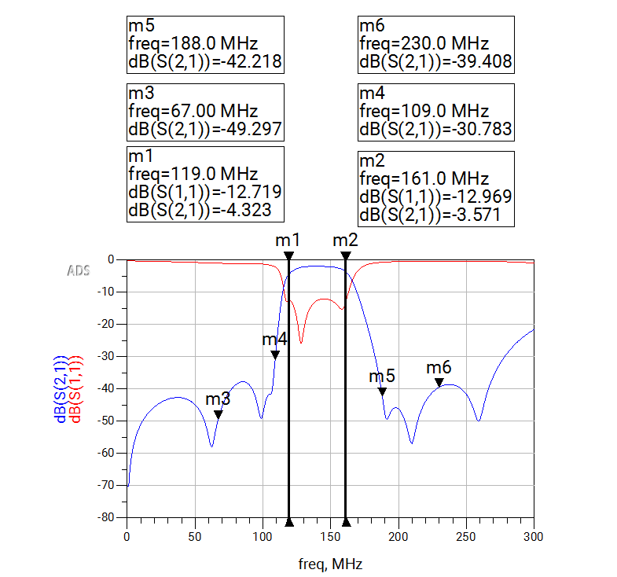</p>

## Specification

| | Value |
|---|---|
| Passband | 119–161 MHz |
| Rejection target | ≥ 40 dB at 109 MHz and 188 MHz, and further out (67 MHz, 230 MHz) |
| Passband ripple / return loss | Ap = 0.11 dB, so RL ≈ 16 dB for each section |
| Impedance | 50 Ω in and out |
| Component losses | QL = 100, QC = 1000 (both at 100 MHz, Q ∝ f), then real 0603 inductor models |

## Design flow

### Low-pass section (sets the upper band edge)
1. **Prototype.** The ADS Filter DesignGuide gives an elliptic low-pass with Fp = 161 MHz, Fs = 188 MHz, As = 40 dB, N = 7 and a shunt-C first element. The series arms are L∥C tanks, and each tank creates a transmission zero.
   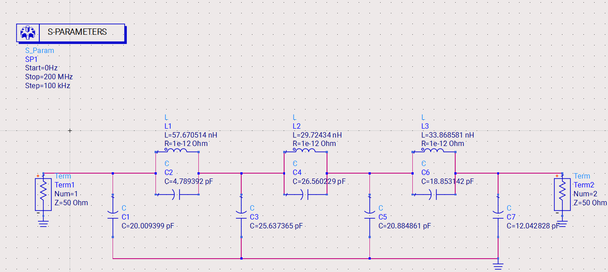
2. **Finite-Q components.** Every L and C was replaced by INDQ/CAPQ models (Q ∝ f).
3. **Extra transmission zeros.** Inductors were added in series with the first and last shunt capacitors, so each of those branches resonates and creates another zero above the band.
4. **Optimisation.** Gradient optimisation in ADS with goals on |S11| in the passband and |S21| in the stopband, giving 16.5 dB return loss and ≥ 40 dB rejection at 188 and 230 MHz.
5. **Real components.** The inductors were replaced by the nearest Coilcraft **0603DC** parts (S-parameter models), and the capacitors were re-optimised.

| Step 4 (optimised, finite Q) | Step 5 (real inductors) |
|---|---|
| 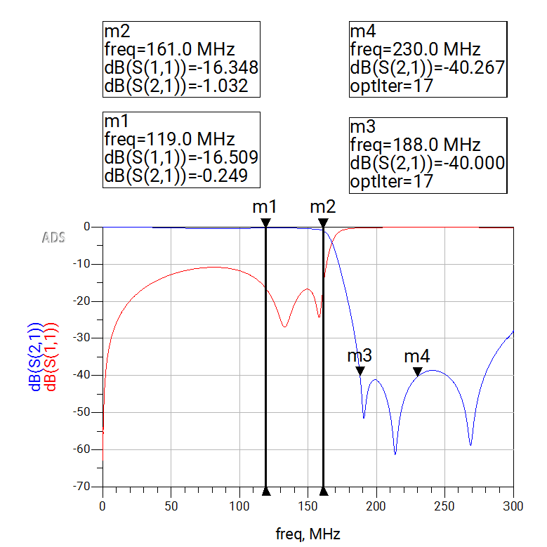 | 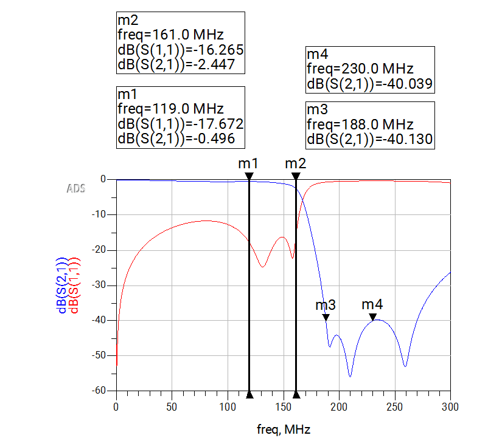 |

### High-pass section (sets the lower band edge)
The structure mirrors the low-pass: series L∥C tanks between shunt inductors. It was optimised for 16 dB return loss above 119 MHz and ≥ 40 dB rejection at 109 MHz and 67 MHz, then built with real 0603DC inductors.

| Optimised, finite Q | Real inductors |
|---|---|
| 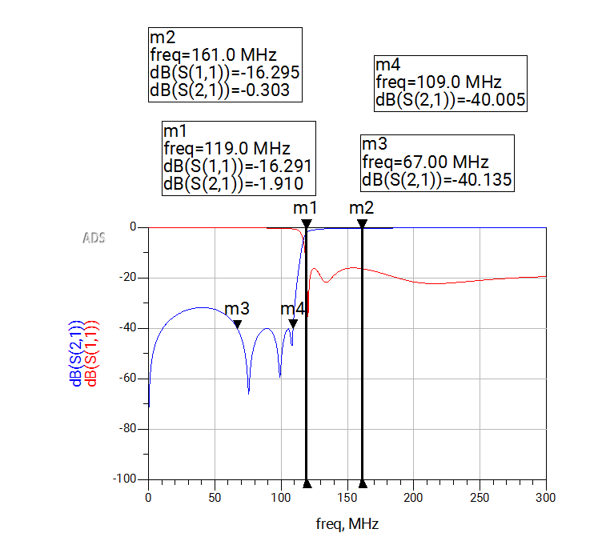 | 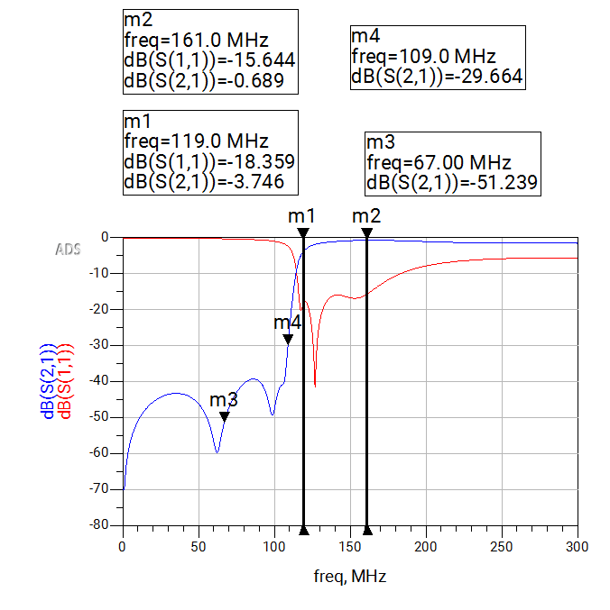 |

### Final band-pass filter
The low-pass section is followed by the high-pass section:

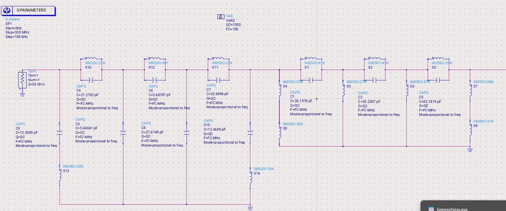

| Marker | Frequency | ADS result (real parts) |
|---|---:|---:|
| Insertion loss, lower band edge | 119 MHz | 4.3 dB (\|S11\| = −12.7 dB) |
| Insertion loss, upper band edge | 161 MHz | 3.6 dB (\|S11\| = −13.0 dB) |
| Rejection | 67 MHz | 49.3 dB |
| Rejection | 109 MHz | 30.8 dB |
| Rejection | 188 MHz | 42.2 dB |
| Rejection | 230 MHz | 39.4 dB |

## Independent verification in Python

[`python/filter_model.py`](python/filter_model.py) rebuilds every stage from ABCD matrices, using the same INDQ/CAPQ loss models as ADS. [`python/analyze.py`](python/analyze.py) compares the results with the ADS markers:

| Circuit | Agreement with ADS |
|---|---|
| Low-pass prototype (ideal) | **Exact** (0.00 dB at all 6 markers) |
| Low-pass, optimised (finite Q) | |S21| within 0.3 dB; |S11| within 0.8 dB at the 161 MHz band edge |
| High-pass, optimised (finite Q) | |S21| within 0.25 dB; |S11| within 0.35 dB |

The remaining difference for the optimised circuits comes from the optimiser values being shown rounded on the schematic. The circuits that use real inductors depend on Coilcraft's measured S-parameter files and are not re-simulated in Python.

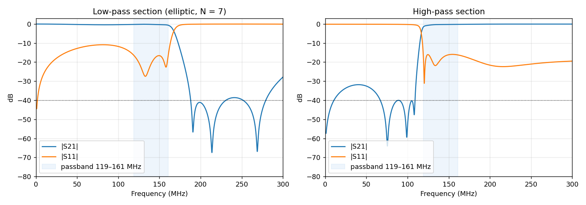

### Finding: what really broke in step 2
In the original flow, adding finite Q made the low-pass response collapse, from −0.1 dB to **−34.8 dB at 161 MHz**. Losses of Q = 100 cannot do that. Re-simulating the stage exactly as it was built shows that the capacitor values were swapped. The variables C1…C7 kept the prototype's alternating shunt/tank numbering, but the schematic used C1–C3 for the tanks and C4–C7 for the shunts.
- **As built:** the re-simulation reproduces the ADS collapse (−34.97 dB vs −34.84 dB at 161 MHz).
- **Mapped correctly:** finite Q costs only about 1 dB at the band edge, and the 40 dB rejection is still met.

The later optimisation recovered from the bad starting point, but starting from the correct prototype would have been faster and closer to the textbook design.

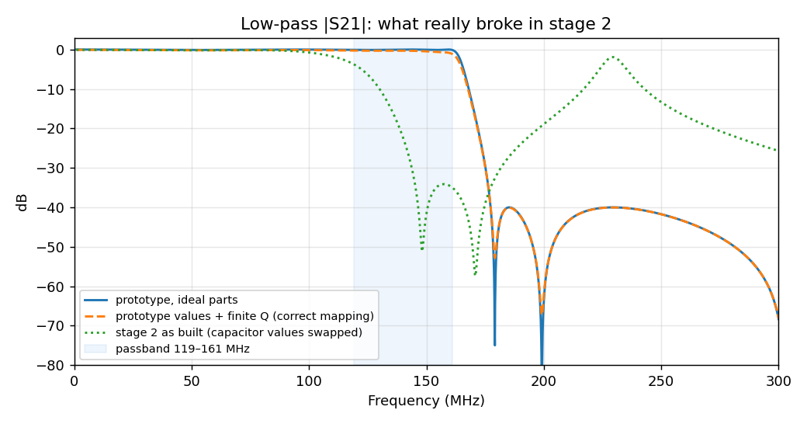

### Band-pass response and group delay (finite Q)
- **Insertion loss:** 0.4–1.7 dB across the band with QL = 100 parts, rising to 3.6–4.3 dB at the band edges with the real 0603DC inductors in ADS.
- **Group delay:** varies from about 14 ns at mid-band to 65 ns at the lower edge, which is typical of the sharp elliptic transition.

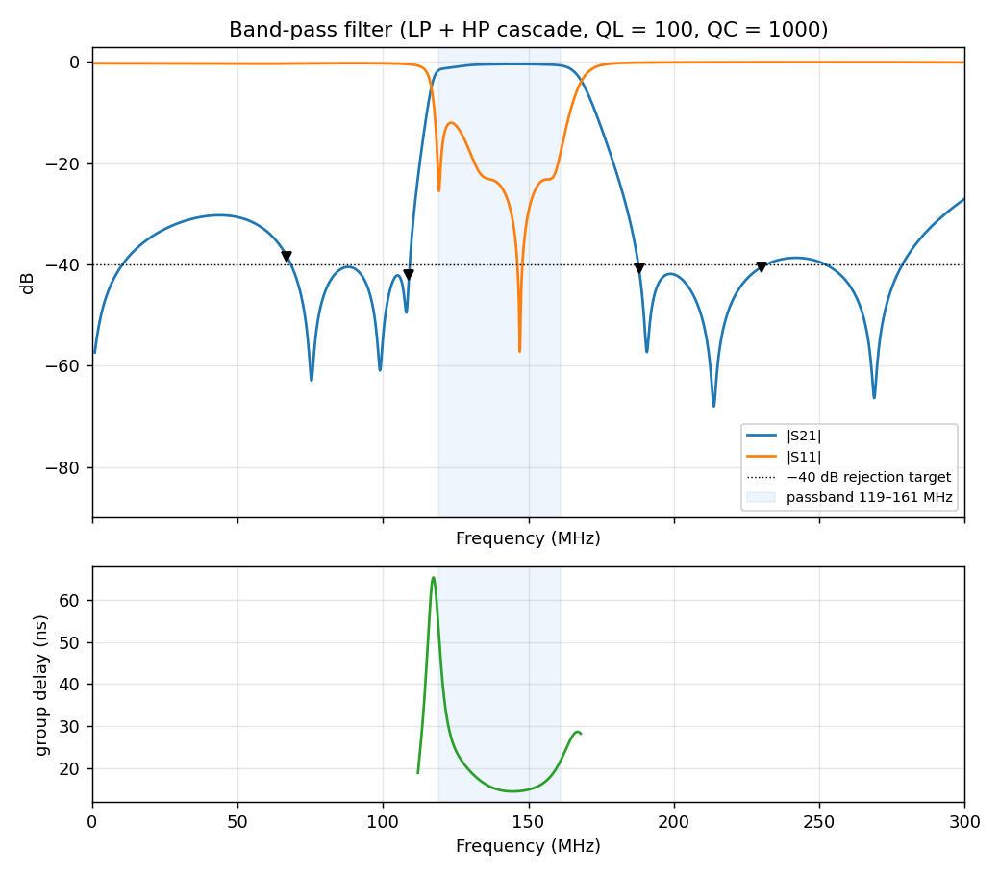

### Tolerance analysis (beyond the assignment)
Every L and C was varied uniformly within ±1%, ±2% and ±5%, with 2000 samples per tolerance level:

| Tolerance | P(rejection ≥ 40 dB) | P(rejection ≥ 35 dB) | Median insertion loss (dB) | 95th percentile insertion loss (dB) |
|---|---:|---:|---:|---:|
| ±1% | 47% | 100% | 1.75 | 2.13 |
| ±2% | 33% | 82% | 1.78 | 2.74 |
| ±5% | 19% | 46% | 2.20 | 7.02 |

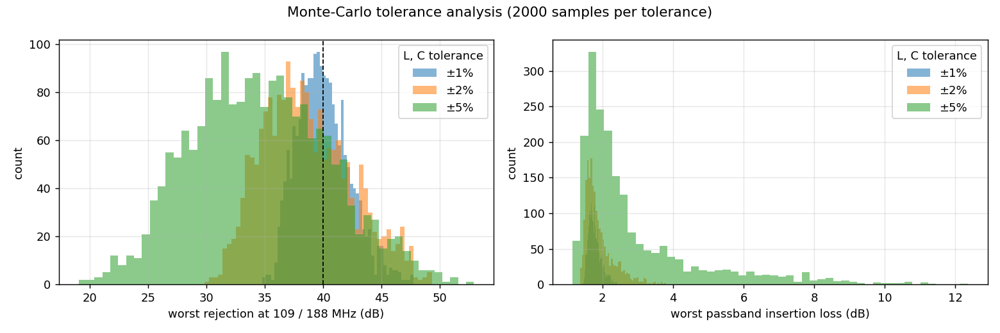

**Takeaway:** the optimiser placed the stopband exactly on the 40 dB limit, so roughly half of all builds would miss the specification even with ±1% parts. For a design that can actually be manufactured, the optimisation goals should include a margin (for example, −45 dB). Alternatively, the zeros could be retuned for yield using ADS's Yield/Yield-Optimisation, which the DesignGuide already offers. 0603DC inductors come in ±2% (G) and ±5% (J) grades. With ±5% parts, fewer than half of the builds reach 35 dB of rejection.

## Repository contents

```
ads/Filter_project_wrk/   ADS workspace (schematics, optimisation set-ups, data displays, datasets)
python/filter_model.py    ABCD-matrix models of every design stage
python/analyze.py         validation against ADS, figures, Monte-Carlo analysis
docs/                     ADS screenshots (ads_*.png) and Python figures (python_*.png)
```

## How to run

**Python** (NumPy and Matplotlib):
```bash
cd python
python analyze.py
```

**ADS:** open `ads/Filter_project_wrk/workspace.ads` (built with ADS 2022 or newer). The real-component cells (`0603DC-*`) use Coilcraft's S-parameter models. Download the **0603DC** `.s2p` files from coilcraft.com, then point each `SNP` component's *File* parameter at them, because the original absolute paths are not included.

## Skills
RF filter synthesis (elliptic, transmission zeros) · Keysight ADS (DesignGuide, S-parameter simulation, gradient optimisation, vendor models) · ABCD/S-parameter network analysis · Monte-Carlo yield analysis · Python and NumPy

## Author
**Sepehr Ebrahimi**, B.Sc. Electrical Engineering, Amirkabir University of Technology (2026)
